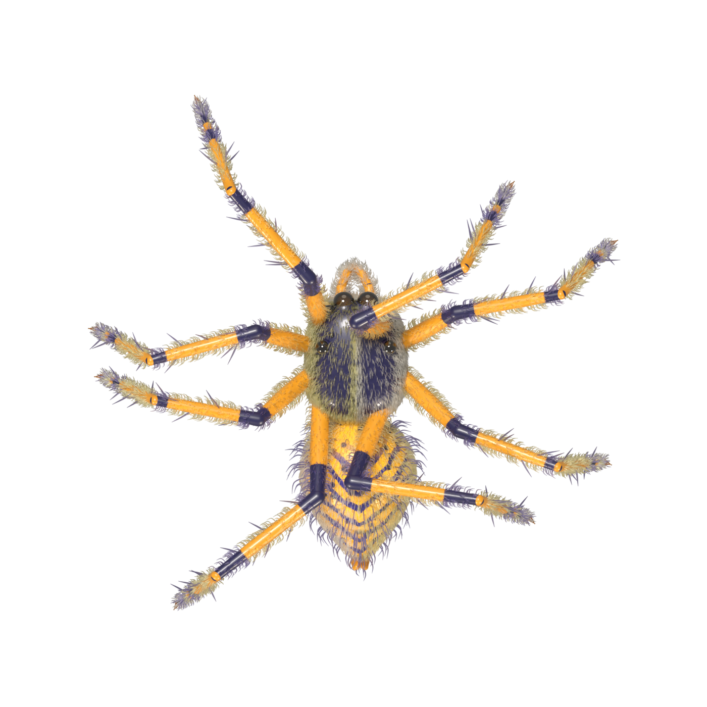

# Spider crawl cursor

[](https://www.npmjs.com/package/spider-crawl-cursor)
[](LICENSE)



A spider that follows your cursor. Modelled, furred and rendered in Blender (Cycles, on the GPU); the page only plays the frames back.
It is its own animal: your pointer stays your pointer, and the spider crawls after it, slowly, the way a real one does.

**[Try it live](https://abhishakth007.github.io/Spider_Crawl_Cursor_Animation/)**, and if you do, **[rate it](https://github.com/Abhishakth007/Spider_Crawl_Cursor_Animation/issues/new?template=feedback.yml)** (one minute, a 1-5 rating and a few words).

## Put it on your page

One line. Nothing to host, no build step:

```html
<script src="https://cdn.jsdelivr.net/npm/spider-crawl-cursor@1/spider-cursor.min.js"></script>
```

That is all: it starts itself and finds its own sprites. It only fetches what it needs: on a desktop two small sheets once the page is idle (so the spider is there the moment the mouse first moves), and on a phone, which has no mouse, nothing at all.
Options go on the tag:

```html
<script src="https://cdn.jsdelivr.net/npm/spider-crawl-cursor@1/spider-cursor.min.js" data-size="40" data-speed="1.5"></script>
```

Other ways:

```bash
npm i spider-crawl-cursor
```

```js
import SpiderCursor from "spider-crawl-cursor";
const spider = SpiderCursor.create({ size: 40 });   // its sprites come from the CDN; pass src to host them yourself
// spider.destroy() when you leave the page (single-page apps)
```

Or copy the `spider-cursor.min.js` and `assets/` folder next to each other on your own server and use a plain `<script src="spider-cursor.min.js">`: it looks for `assets/` beside itself, wherever the page is.
If you call `SpiderCursor.create()` yourself, the automatic start does not also run; add `data-manual` to the tag to switch it off.

## Options

As `create({ ... })`, or on the script tag as `data-size`, `data-speed`, `data-min-width` ...

| option | default | |
|---|---|---|
| `size` | `34` | body length in CSS px, head to abdomen (the legs reach about 1.8x that). Its speed and stride scale with it |
| `speed` | `1` | `1` is a slow crawl; `2` is twice as fast |
| `perch` | `true` | hide the arrow while the spider sits on the pointer |
| `standoff` | `0.7` | how far short of a moving pointer it stops, in body lengths |
| `spawn` | `"edge"` | `"edge"`: comes in from the nearest edge of the window, starting no further than about 7 body lengths from the pointer. `"pointer"`: starts on the pointer |
| `quality` | `"auto"` | `"full"`: every sprite size and gait. `"lite"`: about a fifth of the data and memory, fewer frames and gaits, softer on a retina screen. `"auto"`: full, unless the browser asks to save data, is on a slow connection or reports little memory |
| `motion` | `"auto"` | `"auto"` honours `prefers-reduced-motion`. Also `"full"`, `"reduced"` (one still frame at the pointer) and `"off"` (nothing is fetched) |
| `fidget` | `"auto"` | now and then, while it stands: a wave, a tap or a groom (on with full quality). `false` makes it perfectly still |
| `preload` | `true` | on a desktop, fetch the two sheets it needs as soon as the page is idle |
| `prefetch` | `true` | once it has appeared, quietly fetch the curved-walk sheets within the memory budget |
| `cacheBytes` | `33554432` | decoded-image memory budget (32 MiB), including images still being decoded |
| `shadow` | `true` | soft drop shadow |
| `touch` | `false` | also for touch input (a real mouse on a touch laptop always works) |
| `minWidth` | `0` | do nothing on windows narrower than this many px |
| `src` | next to the script | folder with the sprite sheets (the CDN copy when bundled); the lite sheets are found beside it in `assets-lite/` (`liteSrc`) |
| `manifest` | `false` | read `manifest.json` from `src` (only if you repacked the sheets with other sizes) |

`create()` returns `{ destroy(), set(opts), setSize(px), show(), hide(), position(), state() }`. TypeScript types are included.

## How it behaves

- **It is its own animal.** The pointer stays the pointer. The spider crawls after it (about 2 body lengths a second, a little quicker when the pointer is far away), speeds up and slows down smoothly, and keeps walking until it gets there.
- **It is there at once.** On the first mouse move it appears within a few body lengths of the pointer (it fades in if the edge is far) and scuttles in, quicker than its crawl, so you are looking at it within a second and it has reached the pointer in about three. Then it crawls.
- **It comes up behind you, not onto you.** While you move, it stops about 0.7 body lengths short of the pointer.
- **Hold still and it settles on the pointer.** When the pointer has rested for a moment, the spider walks the last of the way in with its head on the tip. While it sits there the system arrow is hidden (the spider is the cursor); the moment the pointer moves, the arrow is back and the spider is a separate animal again. Clicks, hovers and drags always go to the real pointer.
- **Real gait.** Eight legs in two alternating teams (L1 R2 L3 R4 against R1 L2 R3 L4), each foot on the ground 60 % of the time. The legs run at exactly the speed it travels, so planted feet do not skate.
- **It turns like a walking animal.** The sharper the turn, the more it curves, never sharper than an arc about a body length across, so even a 180 is a swing round with the legs still carrying it forward, not a stop, a spin and a restart. The body bends into the turn (the head leads, the abdomen trails out the far side) and the yaw comes in steps with the legs. Only when the pointer is too close for an arc does it shuffle round on the spot.
- **Standing, it holds still, as a spider does,** and now and then (every 7 to 16 seconds) it waves a front leg, taps a back one, or grooms its fangs, with its breathing and palp twitches in it. Every standing animation starts and ends on the pose the walk stops in, so there is never a pop. Between fidgets nothing changes, so nothing is drawn and the page does no work for it.
- `prefers-reduced-motion` shows one still frame at the pointer: no walking, no perching, no animation loop. `motion: "off"` fetches nothing. A hidden tab does no work and starts no downloads. Touch input is ignored unless `touch: true`. It works under a strict Content-Security-Policy, and several instances can share the page (the arrow stays hidden while any one of them sits on it).

## Why it stays sharp when it is small

A sprite shrunk by the browser is shrunk with a cheap filter, and thin legs and fur turn to mush. So every size is made ahead of time, properly, from a 768 px master: premultiplied (no dark halo on the edge), Lanczos in half steps, then a little sharpening on the colour. There are sheets at 64, 96, 128, 192 and 256 px per frame (`assets/<size>/`), and the page loads only the one nearest the pixels it needs for the size and the screen's pixel ratio (0.7 to 4.8 MB for the visitor; the package holds all five). It is also drawn without ever being resampled twice: the canvas sits on whole device pixels and the sub-pixel part is applied inside the draw.

The **lite** sheets (`assets-lite/`, 0.7 MB for all three sizes) trade that away on purpose: 64, 96 and 128 px only, a 16-frame walk instead of 32, three gaits instead of six, no fidgets. On a retina screen they are about half as sharp and its turns are wider (a 180 takes about 2.3 s over a 74 x 37 px footprint instead of 1.9 s over 42 x 23). They are what `quality: "auto"` picks when the browser asks to save data, is on a 2G connection, or reports 2 GB of memory or less; everyone else gets full quality.

## What it costs the page

Measured in headless Chrome on a retina viewport (software rasterising, so read the numbers relatively), for a spider that has settled on the pointer:

| | data fetched in a session | decoded image memory | CPU while it stands (over a blank page) |
|---|---|---|---|
| 1.0.1 | 3.7 MB | about 60 MB, never released | 15.6 % |
| 1.1.0, full (default) | 3.0 MB | about 25 MB, capped at 32 | 2.9 % |
| 1.1.0, `fidget: false` | as full | as full | 1.2 % |
| 1.1.0, `quality: "lite"` | 0.35 MB | about 4 MB | 0.0 % |

The engine behind those numbers: the animation loop is event-driven and stops completely when nothing changes; decoded sheets live in a bounded cache and are released when not drawn; only the two sheets it needs first are critical, the rest are queued one at a time within the budget; nothing runs in a hidden tab; and stale work from a resize, a destroy or a reduced-motion change can never be published.

## How it was made

`blender/` holds everything that made the frames. Blender 5.2, Cycles on OptiX (a frame takes about 2 s on an RTX 5050 at 768 px, 160 samples).

- `spider_model.py` builds the spider from code: a jumping-spider carapace with all eight eyes (the big forward pair with a faint amber retina, the lateral and the tiny median ones), iridescent chelicerae with fangs, pedipalps, a banded and chevroned abdomen with spinnerets, and eight banded legs of three rigid parts each with ball joints (so a bend never gaps), claws, stiff spines, and about 60 000 hair curves (Cycles hair) in cream and gold, longer on the face as a beard.
- `spider_motion.py` poses it. No armature: a leg is solved from the foot with an analytic IK (the metatarsus keeps its slope, the knee sits on the right side of hip-ankle) and the gait, the body's bob, sway and yaw, and the abdomen's lag are plain functions of the phase, which is what lets the strips loop exactly and lets the page pace them by speed.
- `render_sprites.py` renders the 396 frames: six gait strips of 32 (`walk0`, `walk18`, `walk34`, `walk50`, `walk70`, `pivot`) and four standing strips (`idle_calm`, `idle_wave`, `idle_tap`, `idle_groom`). It skips frames that already exist, so a long render can be stopped and resumed.
- `lookdev.py`, `gait_sheet.py`, `sheet.py` are the look-dev stills and contact sheets used while building it. `blender/spider_pro.blend` is the posed scene.

```bash
# render (about 11 minutes on a laptop GPU); the 768 px masters are not in the repo, this makes them
blender -b --factory-startup -P blender/render_sprites.py -- renders/master --res 768 --samples 160 --elev 76
# pack the sheets for the page (also rewrites the copy of the manifest inside src/spider-cursor.js)
python pack.py renders/master assets
python pack.py renders/master assets-lite --profile lite
# build the files that are published
npm install && npm run build
```

## Developing

`src/spider-cursor.js` is the source; `npm run build` writes `spider-cursor.js`, `.min.js`, `.mjs` and `.cjs` from it, stamped with the version.
`test/` drives the page in Chrome with a real mouse (Playwright):

```bash
npm test          # behaviour, jiggle, chase, api, install, and policy
node test/turn.mjs   # a 180 with the pointer straight behind: how long, how far it walks, which strips
node test/cdn.mjs    # the published package, loaded from jsDelivr by a page on another origin (needs the network)
```

`policy.mjs` covers the engine: nothing fetched before a mouse event, lazy and bounded loading, a hidden tab, destroy during a decode, rapid size changes, reduced motion, shared cursor ownership, the lite/full choice, preload and prefetch, and the idle cost.

`install.mjs` is a stranger's website: the package is served from one origin and the page from another, and it checks every way of using it
(one script tag with no config, data attributes, `create()` by hand, nothing downloaded before the pointer moves, a strict CSP, the ES module).
The tests use Chrome through `playwright-core`; set `PLAYWRIGHT_DIR` if yours lives somewhere else.

## Feedback

Tried it? **[Rate it](https://github.com/Abhishakth007/Spider_Crawl_Cursor_Animation/issues/new?template=feedback.yml)**, or star the repo. I read everything.

## License

MIT, see [LICENSE](LICENSE).
